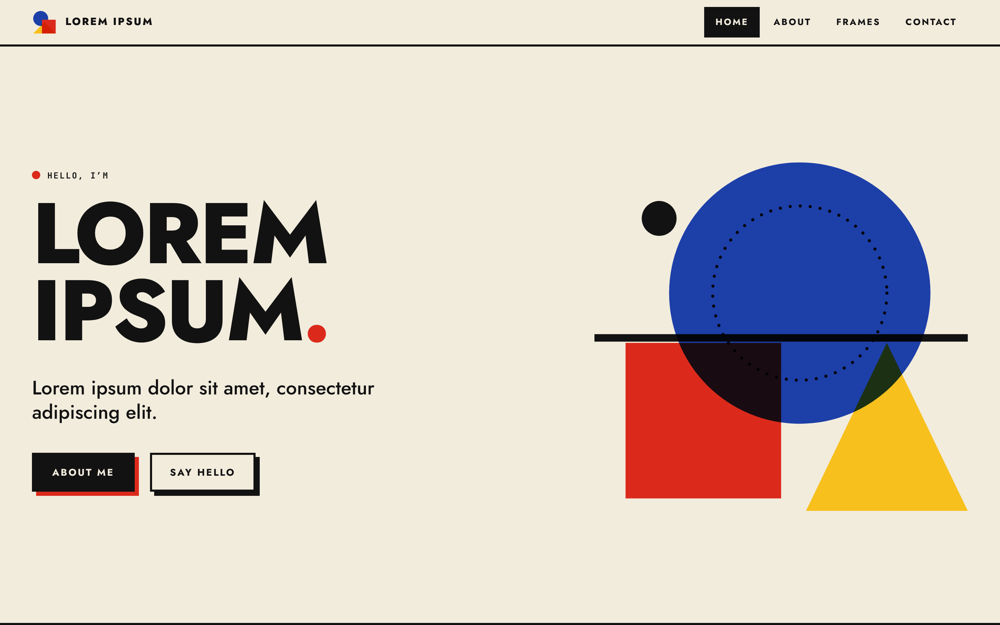
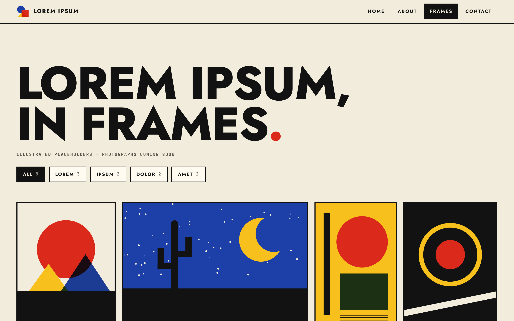
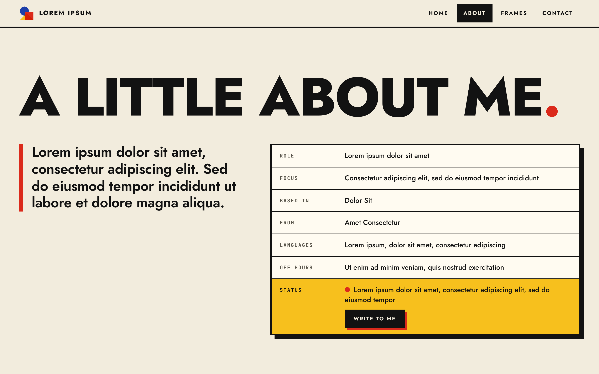
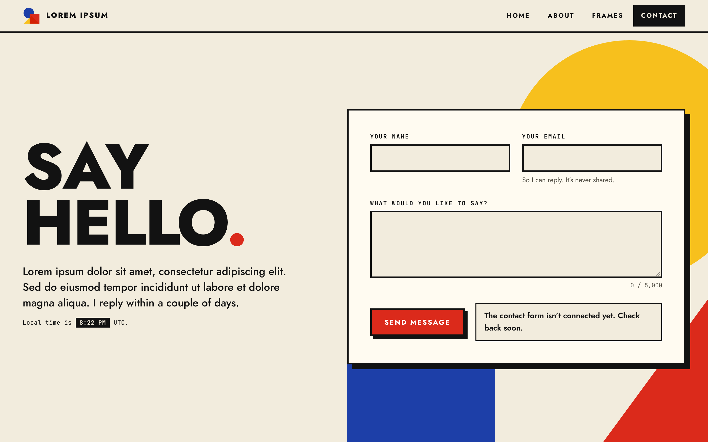
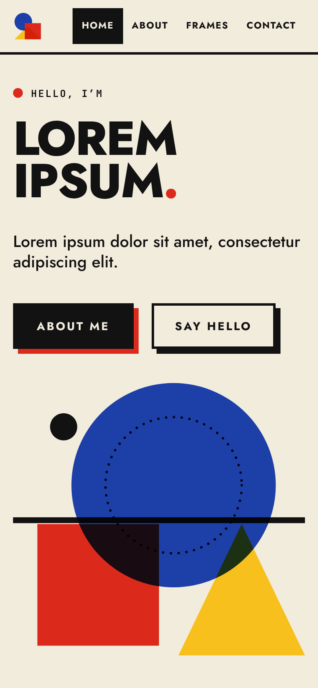

# Bauhaus portfolio template

A minimal, Bauhaus-inspired portfolio website with its own **admin panel**. Use it as the starting point for your personal site: you get a bold geometric home page, a photo gallery, About and Contact pages, and a CMS-style dashboard where you edit your text, upload photos and read messages, without touching code.

**Everything on the site is placeholder "Lorem ipsum" text.** Replace it with your own in the admin, in about ten minutes (see [Make it yours](#make-it-yours)).



| Frames (gallery) | About | Contact | Home on a phone |
| --- | --- | --- | --- |
|  |  |  |  |

**On this page:** [Quick start](#quick-start) · [Make it yours](#make-it-yours) · [Using the admin](#using-the-admin) · [Putting it online](#putting-it-online) · [Commands](#commands) · [Project layout](#project-layout) · [How it works](#how-it-works-for-developers) · [Troubleshooting](#troubleshooting) · [License](#license)

## What you get

| Piece | What it is |
| --- | --- |
| **The website** | Home, About, Frames (gallery), Contact and a 404 page. Animated, fast, works with a keyboard, and respects "reduce motion". |
| **The admin** | A dashboard for messages, gallery photos, page text and settings, with a sidebar that becomes a slide-out menu on phones. |
| **The server** | A small program that stores your content and messages and serves the site and admin. No database to install. |

The site is plain HTML, CSS and JavaScript built with [Vite](https://vite.dev), with no front-end framework. The server uses [Hono](https://hono.dev) and the SQLite database that is built into Node.

## Quick start

**You need** [Node.js](https://nodejs.org) version **22.13 or newer**. Check with `node -v`.

```bash
npm install
npm run dev:all
```

That starts two things:

| Address | What it is |
| --- | --- |
| http://localhost:5173 | Your website. It reloads as you edit files. |
| http://localhost:3001/admin/ | The admin panel. |

**First sign-in:** the first time the server starts it makes up an admin password and prints it **once** in your terminal. Copy it right away, sign in at the admin address, and change it under **Account**. (You can pick your own beforehand: copy `.env.example` to `.env` and fill in `ADMIN_PASSWORD`.)

Want only the website, with no admin? `npm run dev` is enough. The site then shows its built-in content.

## Make it yours

Most things can be changed from the admin. A few live in the files. Here is where everything is.

### 1. Your words and photos: use the admin

Open http://localhost:3001/admin/ and work down the sidebar:

- **Home page:** the tagline under your name, the big intro paragraph, and which words in it turn red.
- **About page:** your intro, the details list, jobs, skills and education.
- **Gallery:** upload your photos. The nine coloured illustrations are placeholders; delete them or leave them as decoration.
- **Settings:** where you're based, what you're open to, your availability, and your social links (a link left empty hides its icon).

Changes appear on the site the next time a page loads, so refresh to see them.

### 2. Your name and site title: edit these files

Your name appears in a few places that the admin doesn't control. Search for `Lorem Ipsum` in these files and replace it:

| File | What it changes |
| --- | --- |
| `index.html` | The big name on the home page (the two lines in the `<h1>`) and the page title and description |
| `about.html`, `gallery.html`, `contact.html`, `404.html` | Each page's browser-tab title and search/share description |
| `partials/nav.html` | The name beside the logo in the top bar |
| `partials/footer.html` | The copyright name in the footer |
| `partials/head.html` | The site name used when your link is shared |

Page headings and button wording (such as "A little about me" or "Say hello") are also in these HTML files, so edit them there. In `about.html` you can also edit the **career roadmap chart**, which is not in the admin.

### 3. Time zone

The clock on the home and Contact pages shows UTC. In `index.html` and `contact.html`, change `data-tz="UTC"` to your own, for example `data-tz="America/New_York"`, and change the label after it. [List of time zone names](https://en.wikipedia.org/wiki/List_of_tz_database_time_zones).

### 4. Colours and fonts

Edit `src/styles/tokens.css`. The palette is paper, ink and the three Bauhaus primaries (`--red`, `--yellow`, `--blue`), and the fonts are Jost and JetBrains Mono.

### 5. The logo

The three-shape logo in the top bar and footer is plain markup in `partials/nav.html` and `partials/footer.html`. Replace it with your own.

### 6. The Contact form

With the server running, messages go to your admin **Inbox**. If you publish only the static site (no server), messages go to a form service instead. See [Option C](#option-c-the-site-only-no-server).

## Using the admin

The sidebar starts with the **Dashboard**, then has three groups.

- **Dashboard** is the start page: unread messages, gallery counts, when each page was last saved, recent messages, a feed of recent activity, and quick actions.

**Content**
- **Home page** and **About page** are forms for your text.
- **Gallery** lets you upload, caption, reorder and delete photos. Photos are checked and stored safely, up to 8 MB each. Resize large photos to about 2000 pixels on the long side first.

**Messages**
- **Inbox** shows messages sent through your Contact page. Open one to mark it read, reply by email, or delete it.

**Site**
- **Settings** holds your location, availability and social links.
- **Account** changes your password.

## Putting it online

The easiest way is to run **one server that does everything**: it serves the website, the admin and your uploaded photos from one address.

### Option A: one server (recommended)

On a computer or hosting service that can run Node.js:

```bash
npm install
npm run build
NODE_ENV=production npm run server
```

Then:

1. **Put it behind HTTPS.** A tool such as [Caddy](https://caddyserver.com) or nginx can do this.
2. **Keep it running.** Use something like pm2 or systemd so it restarts if it stops.
3. **Set your options** in a `.env` file (copy `.env.example`):

| Setting | What it does |
| --- | --- |
| `PORT` | The port to listen on (default `3001`) |
| `HOST` | `127.0.0.1` keeps it private to this computer (default). Use `0.0.0.0` to accept outside connections. |
| `DATA_DIR` | Where the database and photos are kept (default `data`) |
| `ADMIN_PASSWORD` | The admin password, used on first run only |
| `COOKIE_SECURE` | Set to `1` so the sign-in cookie is only sent over HTTPS (also on by default when `NODE_ENV=production`) |
| `TRUST_PROXY` | Set to `1` only behind a proxy you control. Preserve the public `Host` and have the proxy set `X-Forwarded-Proto` to the public scheme and sanitize `X-Forwarded-For`. |
| `CORS_ORIGINS` | Other websites allowed to use the server's API (see Option B) |
| `MAX_MESSAGES` | Stop accepting new messages after this many (default `5000`) |

**Back up the `data/` folder.** It holds all your content, messages and photos.

### Option B: site on GitHub Pages, server elsewhere

Keep the public site on free GitHub Pages and run the server somewhere else. The site then reads its content from the server.

1. On the server, set `CORS_ORIGINS=https://YOUR-NAME.github.io`.
2. In your GitHub repository go to **Settings → Secrets and variables → Actions → Variables** and add a variable named `API_BASE` with your server's address, for example `https://admin.example.com`.
3. Turn on Pages: **Settings → Pages → Source: GitHub Actions**. The included workflow (`.github/workflows/deploy.yml`) tests and publishes the site whenever you push to `main`.

### Option C: the site only (no server)

Publish the built site to GitHub Pages (step 3 above) without a server. The pages show the content written in the HTML files, and you edit them by hand. For the Contact form, create a free key at [web3forms.com](https://web3forms.com), paste it into `src/config.js` (`key: 'your-access-key'`), and messages are emailed to you. Until you add a key, the form politely says it isn't connected. (To use [Formspree](https://formspree.io) instead, set `provider: 'formspree'` and use your form ID as the key.)

## Commands

| Command | What it does |
| --- | --- |
| `npm run dev:all` | Starts the website and the server together for development |
| `npm run dev` | Starts only the website (port 5173) |
| `npm run server` | Starts only the server and admin (port 3001) |
| `npm run server:watch` | The same, restarting when server files change |
| `npm run build` | Builds the finished website into `dist/` |
| `npm run preview` | Serves `dist/` locally to check the build |
| `npm test` | Runs all the tests |
| `npm run test:watch` | Runs the tests again whenever a file changes |
| `npm run admin:reset` | Sets a new admin password and prints it (use it if you forget yours) |

## Project layout

```
index.html, about.html, gallery.html, contact.html, 404.html
                  The pages. Any .html file in this folder becomes a page.
partials/         HTML shared by every page: head, top bar (nav) and footer
public/           Files copied as-is (robots.txt, and photos if you add them by hand)
src/              The website's code
  main.js           Starts every page
  components/       One file per interactive piece (gallery, clock, form, ...)
  core/             Shared building blocks (scrolling, content loading, helpers)
  data/             The gallery frames and their Bauhaus artwork
  scenes/           Draws the artwork onto canvases
  styles/           CSS, one file per area; tokens.css holds colours and fonts
server/           The back-end: index.js starts it, app.js has the routes
admin/            The admin website (plain HTML, CSS and JavaScript, no build step)
data/             Your database and uploaded photos (created on first run; not in git)
tests/            Automated tests for the site and the server
build/, scripts/  Small helpers for the build and for dev:all
```

## How it works (for developers)

You don't need any of this to use the template. It's here for when you want to change how things behave.

### The website

- **Pages are plain HTML** that start with `<!-- include: head.html -->`, `<!-- include: nav.html -->` and `<!-- include: footer.html -->` to share the common parts. In page and partial HTML, write `%BASE_URL%` for links to the home page so they work when the site is hosted in a sub-folder (as on GitHub Pages).
- **Adding a page:** copy `404.html`, rename it, and it's built automatically. To list it in the top bar, add a link with `data-page="your-page"` in `partials/nav.html`.
- **Components** are small scripts attached to elements with `data-component`:

  ```html
  <span data-component="clock" data-tz="UTC"></span>
  ```

  Each name maps to a file in `src/components/` that exports `mount(element)`. To add one: create `src/components/my-thing.js` with `export function mount(el) { … }`, register it in `src/components/index.js`, then use `<div data-component="my-thing"></div>`. Add `data-hydrate="visible"` to load a component only when it scrolls near the screen.
- **Useful helpers** in `src/core/`: `onScroll()` and `onResize()` (one shared loop for scroll effects), `createStore()` (shared state), `reveal()` (fade in on scroll; add `class="rv"` in HTML), and small DOM and math helpers.
- **Page transitions:** in browsers that support them (Chrome, Edge, Safari 18.2+), moving between pages slides the new page in; others get a fade. Reduced-motion visitors get none. The CSS is in the `<style>` block of `partials/head.html`.
- **Page readiness:** static HTML can paint immediately. The `page-ready` performance mark records when components, eager images and fonts have finished loading.
- **Gallery by hand:** frames live in `src/data/frames.js`. To use a real photo without the admin, put it in `public/photos/` and add `src` and `alt` to the frame. `npm test` checks every frame is complete.

### How the website gets its content

When the page loads it asks the server for `/api/site` (`src/core/site.js`) and fills the page with the answer (`src/core/apply-site.js`). If the server isn't there, it quietly keeps the content already in the HTML. Text is always inserted as text, never as HTML.

### The server

- Routes are in `server/app.js`: a public API (`/api/site`, `/api/contact`), the admin API (`/api/admin/...`), the admin pages, uploaded photos, and the built site.
- Data is stored with Node's built-in SQLite (`server/db.js`) in `data/site.db`. Uploaded photos go in `data/uploads/`.
- Tests for the server are in `tests/server/` and run against a real server on a random port.

### How it keeps things safe

- Passwords are stored as salted scrypt hashes. Sign-in cookies are `HttpOnly` and `SameSite=Strict`, and only a hash of each session token is stored.
- Wrong passwords are rate limited (8 tries per 15 minutes), and so are contact messages (5 per hour per visitor, plus a hidden field that catches spam bots).
- Admin requests that come from other websites are refused.
- Photos are accepted only if their contents really are JPEG, PNG, WebP or AVIF (SVG is refused because it can carry scripts). They are stored under random names.
- Everything typed into the admin or the Contact form is checked and length-limited. Links must be `https://`, `http://` or `mailto:`.
- The admin page blocks inline scripts and loads only its own files.

## Troubleshooting

**I forgot the admin password.** Stop the server and run `npm run admin:reset`. It prints a new password.

**"The site has not been built yet" at http://localhost:3001.** That address serves the *built* site. Run `npm run build` first, or use http://localhost:5173 while developing.

**The admin works but my changes don't show on the site.** In development, open the site at http://localhost:5173 (not 3001) and make sure `npm run dev:all` is running, so the site can reach the server. Then refresh the page.

**An error mentioning `node:sqlite`.** Your Node.js is too old. Install version 22.13 or newer.

**"Port already in use".** Another program is using 5173 or 3001. Stop it, or change `PORT` in `.env`. If you change the server's port, also set `API_PORT` to the same number when you run `npm run dev`, so the site can find it.

**The Contact form says "isn't connected yet".** The site can't reach the server. Start it with `npm run dev:all`, or add a form-service key (see [Option C](#option-c-the-site-only-no-server)).

**A photo won't upload.** Photos must be JPEG, PNG, WebP or AVIF and at most 8 MB. Resize big photos first.

## License

[MIT](LICENSE). You can use, change and share this template, including for your own site or for clients, as long as the license notice stays with the code.
